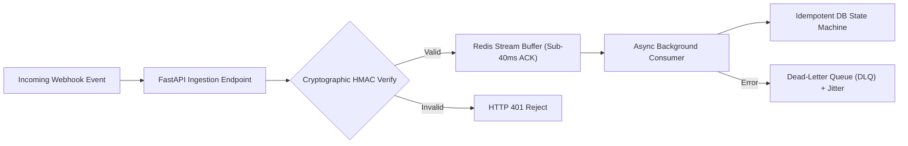

# Engineering Blueprint: Building a Zero-Loss FastAPI Webhook Ingestion Engine with <40ms ACKs

**Author:** MHAMED ASKOURE | Production Engineering Storefront  
**Target Systems:** Enterprise Webhook Gateways (Stripe, Slack, Linear, GitHub, Custom APIs)  
**Production Code:** [`zongsm-cmyk/llm-reliability-rescue-demo`](https://github.com/zongsm-cmyk/llm-reliability-rescue-demo)  

---

## 1. The Production Ingestion Challenge

When upstream webhooks burst during flash events or scheduled syncs, handling payload parsing, cryptographic validation, and database persistence synchronously inside the request loop leads to:
* **Worker Thread Starvation:** FastAPI / Uvicorn worker pools get exhausted waiting for slow downstream writes.
* **HTTP 504 Gateway Timeouts:** Third-party webhook providers drop endpoints after 5-10s timeouts.
* **Cascading Retries & Double Billing:** Unhandled retries cause duplicate state updates.

---

## 2. The 4 Pillars of Resilient Webhook Ingestion

### 1. Sub-40ms HTTP 202 Acceptance
Never process business logic inside the HTTP handler. Immediately buffer raw payloads into Redis Streams and return `HTTP 202 Accepted` in <40ms.

### 2. Zero-Allocation HMAC Signature Verification
Verify cryptographic HMAC signatures before decoding full JSON structures to prevent CPU resource exhaustion attacks.

### 3. Distributed 24-Hour Idempotency
Enforce distributed deduplication on `event_id` or webhook signature to drop duplicates and eliminate double billing.

### 4. Dead-Letter Queue (DLQ) with Decorrelated Full Jitter
Automatically isolate malformed payloads into an inspection queue with exponential backoff:
$$\text{Sleep} = \text{uniform}(0, \min(\text{max\_delay}, \text{base} \times 2^{\text{attempt}}))$$

---

## 3. Production Delivery Packages

* 🛡️ **$149 — Enterprise Webhook Ingestion Engine:** Drop-in FastAPI + Redis Stream engine with HMAC verification and idempotent state machines.  
  👉 [Instant PayPal ($149)](https://paypal.me/asskoure/149)
* 📦 **$9 — n8n Workflow Preflight Auditor:** Local JSON schema validation & production preflight checklist.  
  👉 [Buy on Gumroad ($9)](https://mhamedasskoure.gumroad.com/l/n8n-workflow-preflight-auditor)
* 🤖 **$24 — Agent Runaway Guard Kit:** Anti doom-loop circuit breakers & AI cost regression protection.  
  👉 [Buy on Gumroad ($24)](https://mhamedasskoure.gumroad.com/l/agent-runaway-guard-kit)
